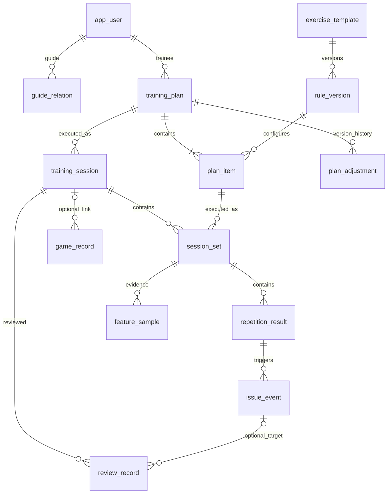

# 数据库设计说明

用户通过指导关系连接计划和会话。一次会话包含多个组，一组包含多次动作；每个动作关联问题事件，每组保存可定位到会话相对时间的特征样本。报告动态聚合生成，人工复核新增记录，不覆盖原始事件。

关系表用于可查询的业务事实；会话中的 `rule_snapshot` 保存完整历史要求，是有意保留的版本快照，不代替计划和规则关系表。`valid_reps`、`total_reps` 等是结果入库事务中同步更新的汇总字段，用于列表展示。

当前 `guide_relation.trainee_id` 唯一，表示一个训练者只有一位当前指导者。未来多指导者协作需要修改此约束与权限规则，不能只改前端。

`review_record.event_id` 可空：为空表示总体反馈，有值表示具体事件。服务层另行验证事件确实属于同一会话。`game_record.session_id` 可空，表示独立互动或关联训练。

索引包括历史会话查询 `(trainee_id, started_at)`、事件定位 `(session_id, event_time)`、同组动作唯一键 `(set_id, rep_index)` 和同会话特征时间唯一键 `(session_id, sample_time)`。

`02_queries.sql` 包含计划联查、日统计、问题分布、最新复核结果、版本追溯、指导者归属查询和 EXPLAIN 示例。

## 0.2 摄像头数据扩展

当前共 17 张表。`observation_record.session_id` 是主键及外键，与 `training_session` 一对一。`assessment_json` 保存指标、来源、模型和工程规则版本；`captures_json` 保存带时间戳、侧别、画面尺寸的原始关键点，用于复核。关系表继续负责组、动作、问题和可查询的特征；不会只保存最终分数。

`repetition_result` 的幅度、节奏、躯干、保持字段允许 NULL，表示没有做该项评价。`feature_sample.angle` 允许 NULL，表示观测缺失。NULL 与 false、0° 的含义不同，统计时不得当成“不达标”或“关节伸直”。`valid_reps` 是历史兼容的汇总字段，仅目标模式表示幅度、循环节奏与保持全部满足次数，不包含尚未验证的躯干稳定判断；仅观察模式不评价该指标。对照模式请查看报告 `evaluation_mode`。

`plan_item.cycle_min_seconds`、`cycle_max_seconds` 保存个体完整循环时长，包含保持。旧计划为空时回退到已关联规则版本的时长；旧会话仍使用当时的计划快照。

H2 启动执行增量迁移，不删除业务记录。既有 MySQL 数据库先备份并执行 `03_upgrade_camera_mysql.sql`；个体循环字段由启动时的元数据检查补充。新建库直接执行 `01_schema_mysql.sql`。MySQL 实例尚未联调。

摄像头分析在事务外执行，事务内锁定会话并检查状态，然后保存关系表结果和观察记录。重复或并发完成不会重复保存。测试使用内存数据库检查正常写入、并发防重、人工复核和旧流程回滚。
