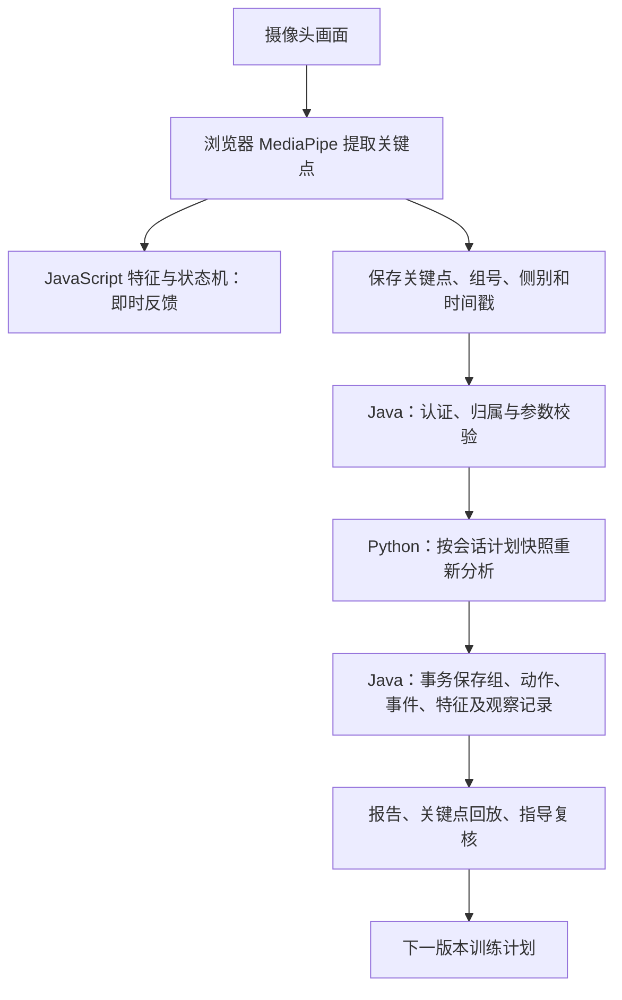

# 0.2 版本更新记录、实现说明与后续优化规划

记录日期：2026-11-13（中国时间）。

项目题目：《融合视觉姿态感知与动作质量评估的智能康复训练辅助平台设计与实现》。

主项目位置：`E:\2025work\6-project\project1_work\rehab-platform`。

本文依据当前源码、开发检查点和已有验收记录整理。本次只更新文档，未增加业务功能、未重启服务、未重新执行上一轮测试。文中的“已通过”均指 `TEST_REPORT.md` 中已记录的验收结果；后续规划不属于已完成功能。

## 1. 当前版本的定位

当前版本以普通摄像头为主要输入，围绕肩肘上肢训练建立计划、动作观察、规则反馈、训练报告、关键点回放和指导者复核流程。三个动作是肩前屈、肩外展和肘屈伸。

系统采用 Vue 3、Element Plus 和 ECharts 构建交互页面，采用 Java、Spring Boot 和 MyBatis 实现业务与数据库访问，采用 MediaPipe 提取人体关键点，采用 Python 计算动作特征与循环结果。默认数据库为 H2 文件库，另提供 MySQL 建表和升级脚本。

动作说明对应 AAOS / ASES 的公开指导资料；目标幅度、组次、节奏和保持时间属于个体计划配置。系统目前输出“动作观察报告”，尚未完成临床测量验证，也没有已经训练和验证的 PyTorch 康复质量分类器。

可以把本次工作的主线概括为：

> 从模拟训练流程，推进到可接入真实摄像头关键点、可解释规则分析、可追溯入库与可人工复核的训练观察原型。

## 2. 0.1 到 0.2 的主要变化

| 方面 | 0.1 版本 | 0.2 版本 | 价值 |
| --- | --- | --- | --- |
| 训练输入 | 确定性生成的模拟动作特征 | 新增真实摄像头采集和人体关键点输入；保留模拟接口用于回归 | 训练页面具备接入实际动作的基础 |
| 姿态模型 | 尚未接入 | 本地 Pose Landmarker Full 权重及 WASM | 模型加载与推理资源不依赖运行时 CDN |
| 动作说明 | 课程演示文字及骨架示意 | 三动作步骤、机位、原文链接和适用条件 | 能说明动作依据及适用范围 |
| 动作计算 | 模拟角度的规则判断 | 关键点几何、平滑、起始校准、阶段识别、完整循环计数 | 动作结果可追溯到输入关键点 |
| 识别异常 | 主要面向模拟数据 | 可见性、出画、多人、投影异常和遮挡重置 | 减少缺失观测造成的错误计数 |
| 反馈模式 | 按演示目标输出结果 | 默认仅观察；可切换个体目标比较 | 明确哪些情况做了目标评价 |
| 节奏配置 | 主要采用关联规则的默认值 | 计划明细支持个体完整循环时长 | 指导者可以调整本次训练节奏要求 |
| 报告 | 模拟训练汇总 | 新增采集可靠性、逐动作统计、自报疼痛、结束原因和来源快照 | 更便于解释一次训练的过程 |
| 回放 | 模拟骨架与角度 | 摄像头报告回放实际上传的关键点 | 问题提示有对应的观察证据 |
| 数据库 | 16 张业务表 | 新增观察记录表，共 17 张表 | 保存观察报告和原始关键点数据 |
| 缺失值 | 原质量字段要求非空 | 质量字段与角度允许 NULL | 区分“未评价”“不满足目标”和“缺失观测” |
| 硬件扩展 | 尚无具体方案 | 新增 ESP32 双 BNO055 UART 采集草图与文档 | 为后续穿戴式采集提供起点 |

## 3. 当前功能详细说明

### 3.1 用户、角色与数据归属

系统保留训练者、指导者和管理员三类角色。训练者查看自己的计划与记录；指导者查看负责用户的记录、发布计划和保存复核；管理员查看全部演示业务记录及数据库概览。

后端检查用户与指导关系。登录口令使用 BCrypt 摘要，登录 token 在数据库中保存摘要并设置有效期，退出会撤销当前登录记录。角色和数据归属检查由 Java 执行。

当前使用初始化演示账号，档案及基线以初始化内容为主。完整注册、账号管理和可编辑临床基线界面仍需后续开发。

### 3.2 训练动作库与专业资料

| 动作 | 观察机位 | 主要特征 | 已核对的参考 |
| --- | --- | --- | --- |
| 肩前屈（主动前举） | 侧面，训练侧朝向镜头 | 髋—肩—肘的图像平面夹角 | AAOS / ASES，Shoulder Forward Elevation (Active) |
| 肩外展（主动侧举） | 正面 | 髋—肩—肘的图像平面夹角 | AAOS / ASES，Shoulder Abduction (Active) |
| 肘屈伸（无负重观察） | 侧面，上臂与前臂避免朝向镜头 | 180° 减去肩—肘—腕的图像平面夹角 | AAOS / ASES，Elbow Flexion 的动作要点 |

动作库说明记录在 `web/public/exercises.json`，包含步骤、机位、计算含义、原文出处和适用条件。Maven 会把同一份目录打包进 Java，保存报告时再写入来源快照。

当前演示资源采用官方原文及其图示链接。尚未制作或嵌入一套有授权的本地真人示范视频。AAOS 原文中的术后阶段、负重和训练量没有直接变为所有用户的默认处方。

### 3.3 训练计划及个体目标

指导者可以选择动作，配置组数、每组次数、目标幅度、保持时间、休息时间，以及最短、最长完整循环耗时，安排训练日期并发布计划。

本版的完整循环耗时包含保持阶段。调整已有计划会新建下一版本，并保存调整记录；历史训练继续关联旧计划和当时的快照。

当前计划参数的主要范围如下，均属于软件原型的配置约束：

| 参数 | 当前范围或规则 |
| --- | --- |
| 动作数量 | 每计划 1～3 个 |
| 每动作组数 | 1～5 组 |
| 每组次数 | 1～20 次 |
| 目标幅度 | 下限不小于 0°，上限大于下限且不超过 180° |
| 保持时间 | 0～10 秒 |
| 组间休息 | 0～300 秒 |
| 完整循环时长 | 0.6～30 秒，最大值不小于最小值及保持时长 |

这些数字不代表统一的医学训练标准。目标模式目前由训练者声明已与指导者核对参数，尚无独立的专业处方审批状态。

### 3.4 摄像头跟练

训练者选择动作组、训练侧和反馈方式后开启摄像头。页面显示动作要求、摄像头画面、骨架叠加、当前投影角度、识别可见性、暂计次数和角度曲线。

预览阶段不产生训练计数；点击“开始本组”后创建摄像头会话并记录关键点。用户可以暂停、继续、结束本组，按计划休息后采集下一组。页面进入后台时会暂停采集，离开未保存页面时有相应提醒。

实现细节与当前限制：

- 默认请求约 640×480 的画面；实际尺寸以设备返回结果为准。
- 采样间隔至少 125ms，目标约 8Hz，实际频率会受到设备性能影响。
- 单会话最多 6000 帧、15 组；摄像头页面在接近一小时的会话相对时间上限前也会停止继续采集。
- 实时曲线保留最近 500 个点；保存时提交完整采集数据。
- 关键点坐标和置信度保留到小数点后 6 位，减少上传体积。
- 本版保存关键点，没有录制或回放原始摄像头视频。
- 次数达到计划值后仍可继续观察，当前没有自动结束本组的机制。
- 未保存数据主要保存在页面内存中，尚无 IndexedDB 草稿恢复或断点续传。

### 3.5 两种反馈模式

| 模式 | 系统处理 | 报告含义 |
| --- | --- | --- |
| `OBSERVATION`：仅记录动作 | 计算循环、角度和采集可靠性，不比较目标幅度、节奏与保持；仍可记录需复核的躯干投影偏移 | 相关目标质量项为 NULL，页面显示未评价 |
| `TARGET`：个体目标比较 | 在训练者确认参数后，比较峰值区间、完整循环耗时和目标区间内的连续保持 | 输出分项结果及偏差事件；计划指标满足次数取幅度、节奏和保持的组合结果 |

当前没有将躯干稳定判定纳入摄像头报告的达标条件，`trunk_ok` 保持 NULL。躯干投影偏移仅作为需要人工核对的事件。

### 3.6 识别可靠性与异常处理

系统检查人体关键点数量、多人入镜、关键关节可见性、关节是否接近画面边缘，以及手臂或躯干投影是否异常。

不可靠帧不参与有效角度评价；角度保存为 NULL。短暂缺失会打断连续保持计时；超过遮挡重置时长后，会中止当前候选循环并重新校准。这样能够保留“未观察到”的事实，减少将缺失观测误判为返回动作的情况。

这些处理目前通过了合成数据测试，仍需在不同穿着、距离、光照和机位下验证实际效果。

### 3.7 训练报告与关键点回放

报告包含训练者、会话时间、输入来源、反馈模式、可靠观测时间、完成循环、计划循环、未完成与中断尝试，以及各动作的峰值中位数、耗时中位数和目标比较结果。

报告还保存可选的训练前后自报疼痛、结束原因、个体目标快照、姿态模型版本、算法版本、工程规则与动作参考来源。用户可点击问题事件定位时间轴，查看对应关键点和角度。未采集区间不补画连续动作，缺失角度保留曲线断点。

导出包括动作结果 CSV，以及浏览器打印或保存 PDF。打印分页尚未单独验收；当前没有服务端生成并归档的正式 PDF 文件。

报告是动作观察记录。二维投影角度、可靠时间比例和完整循环数量各有明确含义，不能分别直接写成临床关节活动度、模型准确率或疗效。

### 3.8 指导者复核与计划调整

指导者可以确认问题、驳回提示或添加总体意见。系统以新增复核记录保留人工操作，不覆盖系统原始事件。报告可进入后续计划调整，发布新的计划版本。

当前只要保存一次复核意见，会话就会转为 `REVIEWED`，没有要求逐条问题全部处理。这属于后续可完善的流程：区分“复核进行中”和“最终复核完成”，并增加明确的最终提交操作。

### 3.9 花朵游戏及 IMU 扩展

花朵游戏保留开合互动、循环次数、时长及训练会话关联，目前使用鼠标和键盘，尚未接入真实手势识别。

硬件目录提供一块 ESP32-WROOM-32 开发板与两块可切换 UART 模式的 BNO055 的采集草图。固件输出两路四元数、时间戳、序号和校准状态，尚未完成 Arduino 编译、实物烧录、肢段安装标定、关节角计算及业务接口接入。

后续将 IMU 用于关节分析时，需要明确安装外参和关节坐标系。传感器相对姿态经过标定与分解后才可构造关节特征；不能直接把两个欧拉角相减解释成可靠的肘屈曲角。

## 4. 本轮代码的组织思路

### 4.1 职责划分



浏览器承担实时交互，Python 根据上传关键点复算最终结果，Java 组织业务和数据库写入。浏览器没有上传一个最终分数就直接决定报告结果。

当前前后端各维护一份即时观察状态机，优点是反馈及时、保存时能复算；代价是规则升级需要同步维护。`tests/observer_parity.py` 用相同合成输入逐帧核对两侧角度、阶段和计数。

### 4.2 关键文件与职责

| 文件 | 当前职责 | 后续修改建议 |
| --- | --- | --- |
| `web/src/components/CameraTraining.vue` | 模型加载、摄像头生命周期、采集、组切换、图表和提交 | 后续拆出摄像头采集、模型推理和会话草稿逻辑，降低单组件复杂度 |
| `web/src/observation.js` | 浏览器即时角度、校准、阶段与计数 | 修改规则时同步核对 Python 与一致性测试 |
| `algorithm/clinical_analysis.py` | 服务端特征、循环分析和观察报告 | 将工程阈值参数化，并为规则版本保留可重放实现 |
| `algorithm/service.py` | `/analyze` 和测试用 `/simulate` HTTP 服务 | 增加结构化日志、请求标识及明确的异常分类 |
| `server/.../Api.java` | API 路由及部分业务入口 | 逐步按认证、计划、训练、复核、统计拆分 Controller |
| `server/.../RehabService.java` | 归属检查、计划版本、会话快照、分析调用、事务保存及复核 | 随业务扩大拆分服务，使用明确 DTO 替代大量 `Map` |
| `server/.../Store.java` | MyBatis SQL 与关系数据读写 | 较长 SQL 可迁移为 Mapper XML；保留外键、唯一约束及行锁 |
| `server/.../ObservationMigration.java` | 增量补字段和调整 NULL 约束 | 后续引入有版本号的数据库迁移工具 |
| `ObservationReport.vue` | 观察指标、来源和目标快照展示 | 增加逐动作问题分布、标准化打印版与复核状态说明 |
| `LandmarkReplay.vue` | 绘制实际上传的关键点 | 后续按时间窗加载，避免长记录一次加载全部证据 |
| `web/public/exercises.json` | 动作依据、步骤、机位与适用条件 | 为说明、资源与审批建立独立版本及管理界面 |
| `web/public/models/manifest.json` | 固定模型的来源、摘要与用途 | 后续增加模型实验记录及兼容性信息 |

表中 `server/.../` 指 `server/src/main/java/edu/course/rehab/`。

### 4.3 角度计算与平滑

先把归一化关键点转换成实际画面像素坐标：

```text
pixel_x = normalized_x × frame_width
pixel_y = normalized_y × frame_height
```

随后计算两个向量夹角。这样能处理画面宽高比例，避免直接在不同尺度的 x、y 上计算角度。

当前角度采用随时间间隔调整的指数平滑：

```text
alpha = 1 - exp(-min(dt, 0.2) / 0.12)
smoothed = previous + alpha × (measured - previous)
```

平滑能够抑制抖动，同时会带来一定响应延迟。后续应根据真人数据同时检查抖动、延迟和峰值偏差，再确定参数。

### 4.4 状态机与完整循环

| 状态 | 含义 |
| --- | --- |
| `CALIBRATING` | 稳定舒适起始姿势，建立角度与躯干投影基线 |
| `READY` | 已完成起始校准，等待动作 |
| `RAISE` | 角度相对起始姿势增加，处于抬起或屈曲阶段 |
| `HOLD` | 目标模式下，处于目标区间 |
| `RETURN` | 从已记录峰值向起始姿势返回 |
| `UNRELIABLE` | 当前关键点不足以可靠评价 |

当前主要工程参数：

| 参数 | 当前实现 |
| --- | --- |
| 关键关节可见性阈值 | 0.65，并结合存在置信度 |
| 起始稳定窗口 | 最近约 1.2 秒内，至少 6 帧、跨度至少 0.7 秒，角度变化范围不超过 6° |
| 启动相对变化 | 相对基线增加至少 12° |
| 返回阶段候选 | 比当前峰值降低至少 6°，持续约 0.15 秒 |
| 返回起始位置 | 回到基线加 6°以内并稳定约 0.2 秒 |
| 完整循环最短时长 | 0.6 秒 |
| 单个候选循环最长时长 | 30 秒 |
| 较长缺失重置 | 距上次可靠观测超过约 0.8 秒 |

识别完整循环后才累计次数，并分别计算峰值、循环耗时、保持和偏移事件。以上阈值是当前工程实现，需要后续实验确定，尚无临床阈值结论。

### 4.5 数据结构与缺失值语义

重要采集结构可概括为下面的 TypeScript 类型示意，省略了具体校验逻辑：

```typescript
type Landmark = {
  x: number
  y: number
  visibility: number
  presence: number
}

type Capture = {
  item_id: number
  set_index: number
  side: 'LEFT' | 'RIGHT'
  width: number
  height: number
  frames: {
    time: number           // 会话相对秒数
    pose_count: number
    landmarks: Landmark[] // 有完整单人结果时为 33 个点
  }[]
}
```

`NULL`、`false` 和 `0` 的区别必须贯穿算法、数据库、接口与页面：

| 值 | 正确解释 |
| --- | --- |
| `amplitude_ok = NULL` | 没有做幅度目标评价 |
| `amplitude_ok = false` | 做了评价，但观测结果未满足本次目标 |
| `angle = NULL` | 当前角度观测缺失或不可靠 |
| `angle = 0` | 计算得到约 0° 的投影角度 |

目前缺失角度已使用 NULL，但无效帧的 `trunk_offset` 仍用 0 占位。后续应增加明确的有效性字段或允许该值为 NULL，避免统计时把占位值解释成躯干稳定。

### 4.6 Java 保存流程与事务

对应 `RehabService.capture()`、`callAlgorithm()`、`saveAnalysis()`，处理顺序如下：

1. 验证训练者身份、会话归属和输入来源。
2. 校验评价模式、目标确认、侧别、画面尺寸、自报数值及模型摘要。
3. 读取创建会话时保存的计划快照，把关键点和快照发送到 Python。
4. Python 重新计算组、动作、特征、问题事件和报告。
5. Java 开启事务并锁定会话行，确认会话仍可完成。
6. 保存组、单次动作、问题事件、特征及观察记录，更新会话汇总。
7. 并发或重复完成请求读取已经保存的报告，避免重复插入。

算法调用放在数据库事务之外，可以减少长时间等待期间的数据库锁占用。多表写入在同一事务中完成，有任一步失败则回滚。

当前仍可能在并发完成时重复调用 Python，但只会成功保存一批结果。后续如分析耗时增加，可加入明确的分析任务和幂等键。

### 4.7 版本快照与历史解释

会话创建时保存计划快照；报告完成时保存算法版本、模型信息、工程规则说明和动作来源。指导者调整计划后生成新版本，原报告不按新计划重新解释。

快照能够保留当时的要求与结果，但“能查看旧报告”与“能重新执行旧算法得到同样结果”是两项能力。后者还需要保存对应算法实现、运行环境和版本注册信息，目前尚未建立完整机制。

## 5. 数据库更新与课程工作量

本版共 17 张表，关系数据负责可查询的业务事实，观察 JSON 负责保留证据和报告快照。

| 数据表 | 作用 |
| --- | --- |
| `app_user` | 用户、角色与密码摘要 |
| `auth_session` | 登录 token 摘要及有效期 |
| `guide_relation` | 指导者与训练者关系 |
| `training_baseline` | 初始化基线及说明 |
| `exercise_template` | 动作模板 |
| `rule_version` | 动作规则版本及默认参数 |
| `training_plan` | 计划主体、状态、日期和版本 |
| `plan_item` | 计划动作、组次及个体参数 |
| `training_session` | 一次训练会话、来源、快照和汇总 |
| `session_set` | 某次训练中的组 |
| `repetition_result` | 单次动作峰值、耗时和分项结果 |
| `issue_event` | 问题类型、时间、观察值和阈值说明 |
| `feature_sample` | 角度、可见性、阶段等时间序列 |
| `review_record` | 人工确认、驳回与总体意见 |
| `plan_adjustment` | 旧计划与新计划的调整关系 |
| `game_record` | 辅助游戏次数、时长及可选会话关联 |
| `observation_record` | 新增；与会话一对一，保存观察报告及关键点采集 JSON |

本轮数据库变化：

- 新增 `observation_record`，主键 `session_id` 同时是会话外键。
- `repetition_result` 中幅度、节奏、躯干、保持结果允许 NULL。
- `feature_sample.angle` 允许 NULL。
- `plan_item` 新增 `cycle_min_seconds`、`cycle_max_seconds`，旧数据为空时使用关联规则的时长。
- 保留外键、动作及特征唯一约束、历史查询索引和问题时间索引。
- 使用增量迁移保留已有数据，并提供 MySQL 升级脚本。

课程文档可围绕指导关系、计划明细、会话与组、动作与事件、复核留痕等关系说明数据库设计，再用事务、约束、索引、联表统计和版本快照展示数据库应用工作量。

## 6. 主要接口与调用链

| 接口 | 用途 |
| --- | --- |
| `POST /api/login` | 登录 |
| `GET /api/plans` | 按权限查询计划 |
| `POST /api/plans` | 发布计划 |
| `POST /api/plans/{id}/adjust` | 发布下一版本 |
| `POST /api/sessions` | 创建训练会话；摄像头客户端明确发送 `data_source: CAMERA` |
| `POST /api/sessions/{id}/capture` | 提交关键点，触发复算并保存报告 |
| `GET /api/sessions/{id}` | 查询结果、事件、关键点及复核 |
| `POST /api/sessions/{id}/reviews` | 新增人工复核 |
| `GET /api/sessions/{id}/export` | 导出动作 CSV |
| `GET /api/overview` | 历史业务统计 |
| `GET /api/database` | 管理员数据库概览 |
| `POST /analyze`，Python 本地服务 | 分析实际提交的关键点 |

`/api/sessions/{id}/simulate` 与 Python `/simulate` 保留用于模拟及回归。摄像头会话不能通过模拟接口写入结果。

## 7. 已验证结果和仍待验证内容

已有验收记录包括前后端构建成功、12 项 Python 规则测试通过、540 帧浏览器与 Python 状态一致性通过，以及隔离数据库中的新旧流程联调、并发防重、事务回滚和计划版本检查通过。

浏览器已检查登录、计划入口与摄像头训练页面。实际摄像头模型推理和真人动作计数没有在上一轮验收中完成；合成关键点不会证明姿态模型或真实动作反馈的准确率。

当前仍待完成：

- 真人在不同机位、左右侧、距离、穿着和光照下的采集与计数测试。
- 参考测量与人工标注，分析角度误差、计数误差、事件提示和重复性。
- 真实 MySQL 实例的建库、迁移和事务回归。
- 打印 PDF 的分页、完整性和可读性检查。
- BNO055 固件编译、烧录、实物采集及标定。
- PyTorch 质量模型的数据、训练、评估和实际推理。

详细证据以 `TEST_REPORT.md` 为准，本记录不增加新的性能或临床结论。

## 8. 后续优化任务与验收标准

优先级说明：P0 为进入下一次正式演示前优先处理；P1 为提升主线完成度；P2 为扩展与研究。下表是规划，不代表已经修改。

| 编号 | 优先级 | 建议更新 | 实现思路 | 完成时的验收标准 |
| --- | --- | --- | --- | --- |
| T01 | P0 | 真人摄像头联调 | 固定动作、机位和测试条件，保留人工计数及问题标注；先用数据定位问题 | 三动作分别有可复现测试记录、失败示例及误差统计，明确样本量和条件 |
| T02 | P0 | 断线恢复与会话取消 | 页面草稿写入 IndexedDB；增加会话取消、异常结束或过期清理状态 | 刷新、关闭或断网后可恢复或明确结束；没有永久挂起且无法处理的会话 |
| T03 | P0 | 反馈文案过期处理 | 将识别状态、阶段提示和问题提示分开管理，增加清除条件与有效期 | 识别恢复后及时撤销旧遮挡提示；短时间重复事件不会持续刷屏 |
| T04 | P0 | 统一缺失值和可靠性字段 | 为躯干偏移及其他特征补充 NULL 或 `valid` 字段；报告与统计按有效帧过滤 | 无效帧不会被统计为 0° 或正常稳定；页面、CSV 与数据库语义一致 |
| T05 | P0 | MySQL 实例验收 | 新建库及旧库升级都执行跨服务、并发和回滚检查 | 实际 MySQL 8 通过建库、升级、外键、事务、NULL、时间与中文数据检查 |
| T06 | P1 | 真人演示资源 | 在专业人员核对后录制有授权的标准机位视频，记录动作与资源版本 | 三动作都有可播放资源、出处或授权说明、机位及适用条件 |
| T07 | P1 | 个体目标确认流程 | 给计划增加目标确认人、确认时间、依据与状态，训练会话引用其快照 | 目标模式绑定已确认计划；旧会话能够查到当时的确认记录 |
| T08 | P1 | 更完整的人工复核 | 增加复核进行中、逐事件处理情况及最终提交操作 | 添加一条备注不会自动表示整份报告完成复核；最终决定可追溯 |
| T09 | P1 | 报告完善与 PDF | 补充保持观察值、偏移峰值、分组结果和指导结论；制作固定打印模板 | 长报告不截表、不丢来源或人工意见；未评价项表达一致 |
| T10 | P1 | 长训练分批上传 | 按时间窗或组分块，使用序号、唯一键和幂等机制；保存结束后统一汇总 | 上传中断可重试，同一块不会重复写入；长训练内存和请求体可控 |
| T11 | P1 | 报告分页与区间回放 | 列表分页、证据按时间窗加载、汇总与原始证据分别查询 | 不为打开列表而加载整段关键点；长记录仍能定位事件和连续回放 |
| T12 | P1 | 同条件趋势统计 | 按动作、侧别、机位、规则、目标和数据来源筛选；区分未评价与不满足 | 模拟与摄像头记录可分开统计，条件改变有标记，趋势不误表述为疗效 |
| T13 | P1 | 规则与代码可维护性 | 提取配置、DTO、服务和观察模块；保存算法版本到实现的映射 | 一次规则升级能定位所有受影响代码，旧数据解释方式明确，测试仍通过 |
| T14 | P1 | 推理性能与加载优化 | 先测推理耗时、实际帧率、内存及界面阻塞；按结果选择 Worker 或分包 | 在指定设备上记录优化前后数据；计数结果与时间戳处理保持一致 |
| T15 | P2 | PyTorch 质量分类器 | 数据采集、片段标注、按人或独立场次划分；先建立可解释基线再训练 | 提供数据说明、独立测试结果、混淆矩阵、F1、规则对比和失败分析 |
| T16 | P2 | BNO055 双传感器实验 | 先编译烧录，验证四元数、校准、安装外参及时间同步，再研究关节特征 | 有真实硬件日志、参考测量和误差记录；缺失数据有明确标记 |
| T17 | P2 | IMU 与视觉联合观察 | 为两类来源定义独立原始数据和统一的上层特征接口，研究同步与冲突处理 | 任一来源失效时能解释反馈依据；是否提高表现由对照实验确定 |
| T18 | P2 | 真实手势花朵游戏 | 接 Hand Landmarker，做开合或捏合标定、阈值滞回和可靠性门控 | 手移出画面或识别失败不增加循环，保存真实输入方式与成绩 |
| T19 | P2 | 档案及基线管理 | 增加档案编辑、基线测量条件、历史版本及归属检查 | 能创建和修改档案，知道某次训练引用了哪次基线 |

T02、T03、T04、T08、T10、T11 的建议由当前代码结构和状态处理推导，属于代码检查发现的改进方向，尚未逐项完成故障复现或修复。

## 9. 建议的后续版本安排

| 阶段 | 建议范围 | 主要交付物 |
| --- | --- | --- |
| 0.2.1：稳定性与验证 | 真人联调、提示清理、缺失值、会话恢复和 MySQL 验收 | 测试记录、修复清单、数据库验收证据 |
| 0.3：训练流程完善 | 个体目标确认、完整复核、真人示范、报告及同条件统计 | 可完整演示和复核的训练业务闭环 |
| 0.4：算法实验 | 数据集、标注工具、规则对比、PyTorch 分类器 | 数据说明、模型、实验结果与限制 |
| 可选硬件分支 | BNO055 采集、标定和关节测量验证 | 实物记录、误差分析及独立接口 |

先完成三动作的实际验证和数据库主线，再决定是否扩展融合传感器或更多动作。具体迭代时长需结合测试结果和课程期限确定。

## 10. 未来总文档可以怎样组织

| 总文档部分 | 当前可复用内容 | 还需要补充的材料 |
| --- | --- | --- |
| 项目概述与需求分析 | 角色、三动作范围、训练到复核流程 | 课程要求、访谈或需求确认记录 |
| 总体设计 | 前端、Java、Python、数据库职责及调用链 | 部署环境和最终架构图 |
| 数据库设计 | 17 张表、实体关系、约束、索引、事务及快照 | 最终 ER 图、字段字典、MySQL 实测结果 |
| 姿态与动作分析 | 几何角度、平滑、校准、状态机、遮挡与分项评价 | 真人采集流程、误差分析和阈值选择依据 |
| 业务实现 | 计划版本、摄像头会话、报告、回放与复核 | 最终页面截图、接口示例及关键代码说明 |
| 模型实验 | 当前可描述预训练关键点模型的用途 | 自建数据集、PyTorch 训练、独立测试及规则对比 |
| 测试与分析 | 已有单元、一致性、事务及隔离库联调记录 | 真人、设备性能、MySQL 和完整 PDF 检查 |
| 总结与展望 | 本文已实现内容和后续任务 | 根据最终完成情况删改，避免把规划写成成果 |

可直接改写进阶段报告的表述：

> 本阶段围绕肩肘上肢训练，将系统由模拟数据流程扩展为基于摄像头关键点的动作观察原型。系统在浏览器中使用预训练人体姿态模型提取关键点，结合几何特征、时间平滑与状态机观察完整动作循环，提供仅记录和个体目标比较两种方式。Java 业务层根据会话计划快照调用 Python 复算结果，通过事务保存训练组、单次动作、问题事件、特征采样和观察报告，并支持关键点回放、指导者复核及下一版本计划调整。本阶段同时补充了动作参考来源、模型与规则版本、缺失值语义和数据归属控制。当前已完成合成输入及隔离数据库流程验证，真人识别表现、临床测量一致性和训练质量分类模型仍需后续实验。

## 11. 后续每次开发建议保留的记录

每项更新至少记录需求来源、实际改动、文件位置、数据库变化、测试方法、结果证据、未测范围和下一步。算法调整还应保留原参数、新参数、数据来源、独立测试条件及优化前后的结果。

可使用同目录的 `开发更新记录模板.md`。有实验数值时填写真实样本量、计算方法和条件；没有测量时填写“未测”，避免在总文档中混用功能完成度和算法性能。

## 12. 相关资料与项目文档

- [运行和代码修改指南](VSCode运行与修改指南.md)
- [模型与动作依据](模型与动作依据.md)
- [硬件采购与烧录](硬件采购与烧录.md)
- [开发检查点](开发检查点.md)
- [测试记录](../TEST_REPORT.md)
- [数据库说明](../database/README.md)
- [AAOS / ASES：Shoulder Surgery Exercise Guide](https://orthoinfo.aaos.org/en/recovery/shoulder-surgery-exercise-guide/)
- [AAOS / ASES：Rotator Cuff and Shoulder Conditioning Program](https://orthoinfo.aaos.org/en/recovery/rotator-cuff-and-shoulder-conditioning-program/)
- [Google：MediaPipe Pose Landmarker](https://ai.google.dev/edge/mediapipe/solutions/vision/pose_landmarker)
