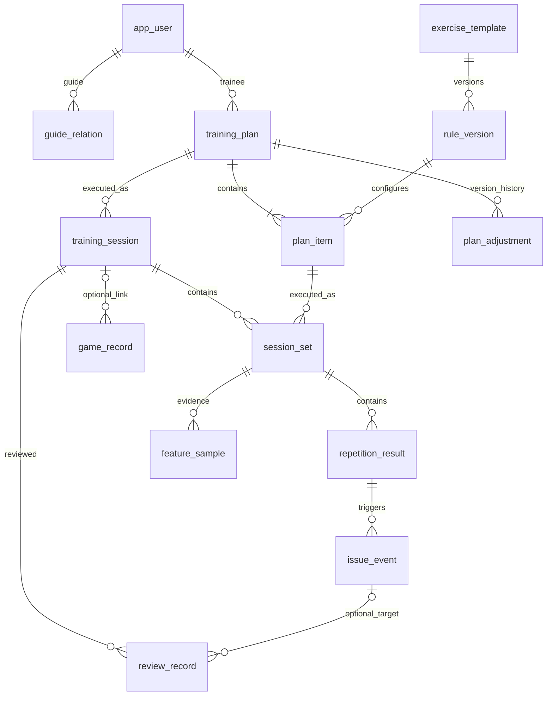

# 数据库设计说明

用户通过指导关系连接计划和会话。一次会话包含多个组，一组包含多次动作；每个动作关联问题事件，每组保存可定位到会话相对时间的特征样本。报告动态聚合生成，人工复核新增记录，不覆盖原始事件。

关系表用于可查询的业务事实；会话中的 `rule_snapshot` 保存完整历史要求，是有意保留的版本快照，不代替计划和规则关系表。`valid_reps`、`total_reps` 等是结果入库事务中同步更新的汇总字段，用于列表展示。

当前 `guide_relation.trainee_id` 唯一，表示一个训练者只有一位当前指导者。未来多指导者协作需要修改此约束与权限规则，不能只改前端。

`review_record.event_id` 可空：为空表示总体反馈，有值表示具体事件。服务层另行验证事件确实属于同一会话。`game_record.session_id` 可空，表示独立互动或关联训练。

索引包括历史会话查询 `(trainee_id, started_at)`、事件定位 `(session_id, event_time)`、同组动作唯一键 `(set_id, rep_index)` 和同会话特征时间唯一键 `(session_id, sample_time)`。

`02_queries.sql` 包含计划联查、日统计、问题分布、最新复核结果、版本追溯、指导者归属查询和 EXPLAIN 示例。
